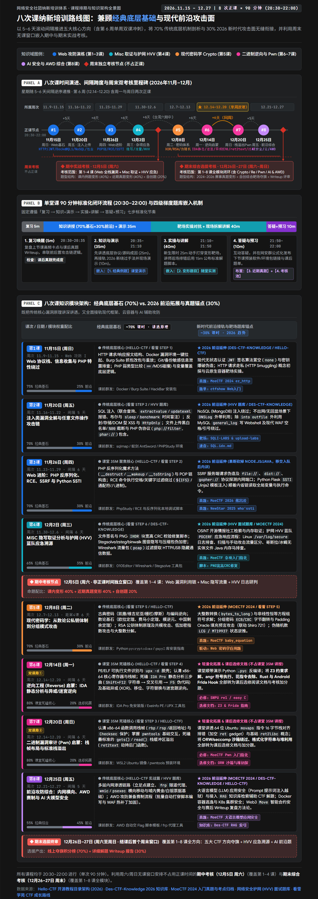
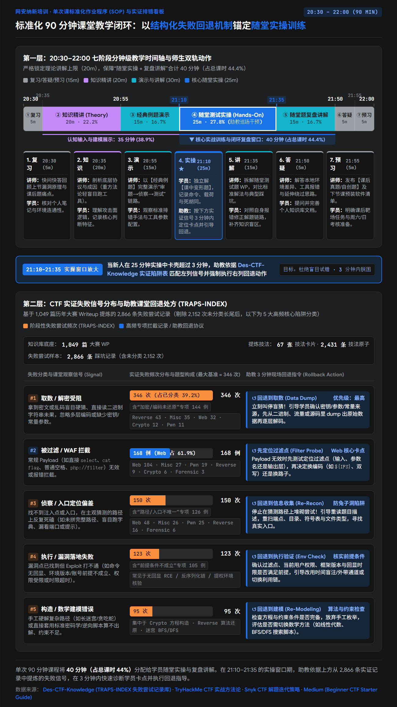
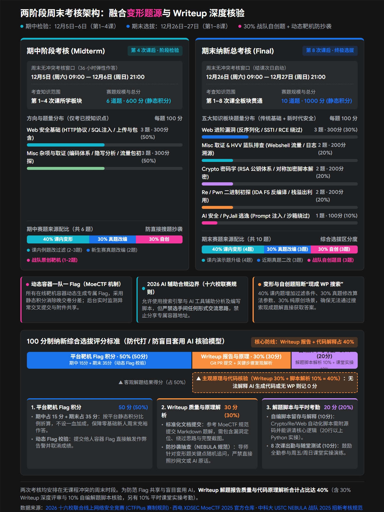

<!-- 脱敏归档版：高校网络安全方向八次课纳新培养体系与标准化教学执行方案 -->

> **适用范围**：高校网络安全社团 / CTF 战队零基础纳新培训（8 次课 · 12 学时标准周期）  
> **在线导航站**：[NEWCTF 学习路线导航站 (index.html)](../index.html) | [全景技术思维导图 (mindmap.html)](../mindmap.html)

# 高校网络安全社团八次课纳新培养体系与标准化教学执行方案

本方案针对11月15日至12月25日共8次纳新课程（每次课20:30–22:00，单次90分钟，总计12学时）制定全流程教学与考核标准。基于高校网安社团（如西电XDSEC、中科大NEBULA等）的培养经验与Hello-CTF、CTF-Wiki、2026 Des-CTF-Knowledge等开源知识库体系，8次课程在有限的12学时内确立了“70%–80%经典底层原理讲透 + 20%–30%新时代攻防演进接轨”的核心基调。全篇正文与可视化架构图严格统一为「第1–3课 Web攻防三阶递进 → 第4课 Misc取证与HVV应急 → 第5课 Crypto现代密码学 → 第6课 Reverse逆向启蒙 → 第7课 Pwn栈溢出启蒙 → 第8课 AI安全与AWD综合」的单一标准主线。

在排期与教学容量控制上，由于单次课“理论精讲(20m)+例题演示(15m)”合计仅35分钟，课程坚决杜绝“多语言/高阶技巧走马观花念PPT”的超载现象：前4次课完成**Web全链路（HTTP/JWT → 注入/上传/包含 → PHP反序列化/RCE/SSRF/Python SSTI）与Misc/HVV流量应急**，果断砍掉Node.js原型链污染与Java Shiro反序列化（移交纳新通过后的Web组内训），并在第4次课后的周六休息日（12月5日）切入期中考核；后4次课进入**Crypto密码学、Reverse逆向（单列第6课）、Pwn栈溢出（单列第7课）与AI/AWD前沿综合**，其中第6、7课课堂35分钟只死磕x86-64栈帧与寄存器、IDA静态分析、基础迷宫/异或逆向及最标准的栈溢出（`ret2text` / 16字节栈对齐 / 基础`ret2libc`），将Z3/angr符号执行、Frida Hook、Rust逆向、ORW沙箱绕过等高阶内容全部转为课后选修文档与加分题，于第8次课后的周末（12月26日–27日）完成期末综合选拔。

## 一、 定基调：12学时纳新课程的知识版图与科学减负策略

### 1.1 学时约束下的核心矛盾与破局思路

纳新培训面临的核心挑战在于**单堂课理论讲授窗口有限（20分钟知识精讲 + 15分钟例题演示 = 35分钟）与网络安全知识体系庞杂之间的矛盾**。若在35分钟内同时塞入PHP、Python、Node.js、Java四种语言的漏洞机制，或从C语言编译直接跨到符号执行与沙箱绕过，零基础新生连基础语法和x86寄存器都认不全，必然沦为走马观花念PPT；反之，若仅讲授十年前的陈旧套路，新生在面对2025–2026年主流高校新生赛（如MoeCTF、NewStarCTF、BaseCTF）及企业级护网（HVV）面试时又会产生知识断层。

结合看雪学苑《CTF基础从入门到实战》、探姬《Hello-CTF》以及中科大NEBULA战队的招新准则，纳新课程的基调定位于“课堂35分钟死磕最核心的底层机制（协议、SQL/文件、PHP与Python核心漏洞、二进制栈帧）；砍掉跨度过大的多语言/高阶对抗，将其转化为课后选修阅读文档或入队后内训”。这一策略具体体现为四大融合与减负维度：

1. **Web安全（第1–3课）聚焦PHP与Python双栈核心，果断剥离Node.js与Java重型组件**：第1–2课讲透HTTP协议、前端源码审计、JWT伪造、SQL注入、文件上传与`php://filter`文件包含；**第3课（Web进阶）严格控量**，课堂35分钟仅保留**PHP反序列化POP链、RCE命令执行绕过、SSRF协议利用（`file://`/`dict://`/`gopher://`）与Python Flask SSTI模板注入**，果断砍掉Node.js原型链污染与Java反序列化（Shiro 550/721、Fastjson），将其移交至纳新通过后的Web组内部进阶培训。
    
2. **Misc与取证（第4课）从“脑洞猜谜隐写”向“HVV蓝队流量溯源与应急响应”升级**：精简纯脑洞类图片隐写，保留核心文件结构（16进制文件头、PNG `IHDR`块宽高CRC32修复、ZIP伪加密与`bkcrack`明文攻击）以培养二进制格式敏感度；同堂贯通**Wireshark流量取证（HTTP/USB/SQL盲注流量）与护网（HVV）蓝队应急响应**，实战演练中国蚁剑、冰蝎（Behinder）加密Webshell流量解密及Linux `/var/log/secure`日志排查。
    
3. **Crypto（第5课）与Reverse/Pwn（第6、7课独立拆分）死磕基础模型，高阶内容转课后选修**：第5课密码学聚焦编码转换、异或（XOR）流密码、伪随机数种子及RSA公私钥数论基础脚本；**第6课（Reverse）与第7课（Pwn）独立排课、严控跨度**——第6课课堂35分钟只死磕PE/ELF与UPX脱壳、x86核心寄存器、IDA Pro静态F5分析及基础迷宫/异或逆向（Z3约束求解、angr符号执行、Android Frida与Rust逆向全部改为课后选修文档/加分题）；第7课课堂35分钟只死磕x86-64函数调用栈帧、最标准的栈溢出（`ret2text`）、64位`movaps`指令16字节栈对齐排错及基础`ret2libc`（ORW/seccomp沙箱绕过、格式化字符串与堆利用全部改为课后选修文档/加分题）。
    
4. **拥抱AI时代（第8课）：构建“大模型安全/PyJail”与“AWD攻防+AI辅助解题规范”双重视角**：2026年全国高校联合赛已明确允许使用互联网与AI问答辅助解题。第8课一方面讲授大语言模型提示词注入（Prompt Injection）、Python沙箱逃逸（PyJail）与AWD攻防赛制流程；另一方面结合2026知识库中的2,866条失败尝试记录（`TRAPS-INDEX`）指导新生科学使用AI辅助编写脚本并规避幻觉死胡同。
    

### 1.2 纳新知识板块总体权重与学时分配架构（与上方全景图完全对齐）

基于上述基调，8次课（12学时）划分为5大知识域（对应第1–8课），各模块的课堂核心、新时代延伸及减负边界如下表所示：

|**知识板块（对应课次）**|**课时分配**|**占总学时比**|**课堂 35m 必须讲透的核心机制（70%–80% 固本）**|**新时代接轨点 & 课后选修/内训分流边界（20%–30% 拓新）**|**对标权威知识库与靶场**|
|---|---|---|---|---|---|
|**板块一：Web攻防演练三阶**      （第1、2、3课）|3次课 (4.5h)|37.5%|**第1课**：HTTP报文、F12/Burp抓包、敏感泄露、PHP弱类型      **第2课**：SQL联合/盲注、WAF绕过、文件上传、LFI伪协议      **第3课**：PHP反序列化POP链、RCE绕过、SSRF协议利用|**课堂延伸**：JWT弱密钥伪造、DNSLog外带、Python Flask SSTI模板注入      **【砍掉移交内训】**：Node.js原型链污染、Java Shiro/Fastjson反序列化|Hello-CTF Web篇、Des-CTF-Knowledge、CTFshow、NSSCTF|
|**板块二：Misc取证与HVV应急**      （第4课）|1次课 (1.5h)|12.5%|文件签名（Magic Bytes）、PNG `IHDR`宽高CRC校验修复、ZIP伪加密与`bkcrack`明文攻击、Wireshark提取HTTP/USB流量|**课堂延伸**：OSINT社工检索、HVV蓝队`PDCERF`应急响应流程、冰蝎/蚁剑Webshell流量解密、Linux `/var/log/secure`排查|八方网域HVV题库、Hello-CTF Misc篇、NewStarCTF 2023–2025|
|**板块三：现代密码学 Crypto**      （第5课）|1次课 (1.5h)|12.5%|编码体系与换表Base64、字节流与大整数互转（`bytes_to_long`）、XOR流密码、RSA数论原理（欧拉函数/模逆元/小指数/共模攻击）|**课堂延伸**：Python（`gmpy2`/`sympy`）自动化求解数论方程、中国剩余定理（CRT）、伪随机数（`random.seed`）状态逆推|CTF-Wiki Crypto篇、看雪Step 5、NewStarCTF 2025|
|**板块四：二进制逆向与 Pwn**      （第6、7课）|2次课 (3.0h)|25.0%|**第6课(Re)**：PE/ELF与UPX脱壳、x86寄存器、IDA静态F5分析、基础迷宫/异或逆向      **第7课(Pwn)**：x86-64栈帧、`pwntools`、标准栈溢出`ret2text`|**课堂延伸**：Python `.pyc`反编译、64位`movaps` 16字节栈对齐排错、基础`ret2libc`      **【转为课后选修/加分】**：Z3/angr、Frida、Rust逆向、ORW沙箱绕过、堆利用|CTF-All-In-One、Hello-CTF Re/Pwn篇、MoeCTF 2024/2025|
|**板块五：AI安全与AWD综合**      （第8课）|1次课 (1.5h)|12.5%|Python内省机制与沙箱限制原理、AWD攻防兼备赛制标准流程（SSH备份、批量攻击脚本编写、WAF热补丁修复）|**课堂延伸**：大语言模型（LLM）Prompt提示词注入越狱、PyJail沙箱逃逸基础、利用`TRAPS-INDEX`规范使用AI辅助解题|MoeCTF 2024–2026 LLM/PyJail篇、Hello-CTF AWD篇|

## 二、 分课程：八次课程排期与进阶主线全景规划（图表与正文完全统一）

结合社团总排期表，网络安全组的8次授课横跨7个教学周（11月9日–11月15日周至12月21日–12月27日周）。在排课节奏上，存在两个关键特征需要教学设计予以适配： 第一，前6次课的授课星期依次为**周日（11.15）→周五（11.20）→周四（11.26）→周三（12.2）→周二（12.8）→周一（12.14）**，每次课之间均保持了5至6天的均匀消化期；前4次课集中攻克可视化程度最高、最好上手的**Web攻防三阶（第1–3课）与Misc取证/HVV应急（第4课）**，并在12月5日（周六休息日）进行期中实战检验； 第二，**第6次课（12月14日周一·Reverse逆向）与第7次课（12月20日周日·Pwn栈溢出）落在同一自然周内（单周双课）**，紧接着5天后即为第8次课（12月25日周五）。因此，第6、7课必须聚焦最核心的IDA静态分析与标准栈溢出`ret2text`，并将免安装IDA Pro与WSL2 Ubuntu调试镜像提前打包下发，避免新生在密集排课周因环境配置或内容跨度过大而掉队。

以下为与上方全景图（Panel A & Panel C）完全一致的8次课程具体模块划分表及排期逻辑：

|**课次**|**具体日期**|**星期**|**所属周次**|**距上次课间隔**|**课程模块名称（与全景图严格一致）**|**所属方向**|**阶段定位与课堂35分钟核心教学目标**|
|---|---|---|---|---|---|---|---|
|**第1次课**|11月15日|周日|11.9–11.15|首次开课|**Web 攻防 I：Web 协议栈、信息收集与 PHP 特性绕过**|Web 攻防 I|掌握HTTP请求/响应结构、F12与Burp抓包改包、敏感信息泄露排查、PHP弱类型比较，延伸现代JWT弱密钥伪造|
|**第2次课**|11月20日|周五|11.16–11.22|5天|**Web 攻防 II：注入类漏洞全解与任意文件操作攻击链**|Web 攻防 II|讲透SQL联合/报错/盲注与WAF绕过、Python二分盲注脚本、反射/存储型XSS，掌握文件上传绕过与PHP伪协议包含|
|**第3次课**|11月26日|周四|11.23–11.29|6天|**Web 攻防 III（减负版）：PHP 反序列化、RCE、SSRF 与 Python SSTI**|Web 攻防 III|课堂聚焦PHP反序列化POP链、RCE过滤绕过、SSRF协议打内网及Python Flask SSTI（砍掉Node.js与Java Shiro移交内训）|
|**第4次课**|12月2日|周三|11.30–12.6|6天|**MISC 隐写取证分析与护网 (HVV) 蓝队应急溯源**|Misc + HVV|掌握PNG宽高CRC修复、ZIP伪加密与`bkcrack`明文攻击、Wireshark提取HTTP/USB流量，实战冰蝎流量解密与HVV日志排查|
|_期中节点_|_12月5日–6日_|_周六/日_|_11.30–12.6_|_课外周末_|**【期中阶段考核】Web 全栈漏洞与 Misc/HVV 半程实战选拔赛**|_Web + Misc/HVV_|_检验第1–4次课（Web三阶 + Misc取证与HVV应急）掌握度，采用静态积分制筛选第一批核心苗子_|
|**第5次课**|12月8日|周二|12.7–12.13|6天|**现代密码学：从数论公私钥体制到流密码/伪随机攻击**|Crypto 密码学|掌握编码与换表Base64、XOR流密码与伪随机种子逆推，完整推导RSA数论原理并用Python攻破小指数/共模/变体模数|
|**第6次课**|12月14日|周一|12.14–12.20|6天(双课周①)|**逆向工程 (Reverse) 启蒙：IDA 静态分析与异或/迷宫逆向**|Reverse 逆向|课堂死磕PE/ELF与UPX脱壳、x86寄存器、IDA Pro静态F5分析及基础迷宫/异或逆向（Z3/angr/Frida/Rust转为课后选修）|
|**第7次课**|12月20日|周日|12.14–12.20|6天(双课周②)|**二进制漏洞审计 (Pwn) 启蒙：栈帧布局与标准栈溢出**|Pwn 二进制|课堂死磕x86-64函数栈帧、`pwntools`交互、标准栈溢出`ret2text`、16字节栈对齐与基础`ret2libc`（ORW/堆转为课后选修）|
|**第8次课**|12月25日|周五|12.21–12.27|5天|**前沿攻防综合：AWD 攻防赛制、PyJail 与 AI 大模型安全**|AI安全 + AWD|掌握大语言模型Prompt注入越狱、PyJail沙箱逃逸基础、AWD批量打点与WAF热修补，建立AI辅助解题与`TRAPS`回退规范|
|_期末节点_|_12月26日–27日_|_周六/日_|_12.21–12.27_|_课外周末_|**【期末纳新总考核】全赛道夺旗赛（Jeopardy）暨战队选拔答辩**|_全方向综合_|_全面考核第1–8次课课堂核心所学（高阶选修仅作附加题加分），结合Writeup防作弊评审确定入队名单_|

## 三、 排列知识点：八次课程核心知识点深度拆解（严控35分钟讲授容量）

本章节按照单堂课“知识精讲(20m) + 例题演示(15m) = 35分钟”的黄金认知容量，详细列出每次课程必须讲透的底层知识点、新旧技术对比以及分流至课后选修/内训的边界。

### 第1次课（11月15日 周日）：Web 攻防 I —— Web 协议栈、信息收集与 PHP 特性绕过

本课必装工具链包括Chrome/Firefox浏览器（配HackBar、Wappalyzer、Proxy SwitchyOmega插件）、Burp Suite Community抓包工具、Docker Desktop（可选）及VS Code。35分钟核心讲授与演示聚焦以下四点：

1. **前端安全误区与敏感信息收集（8分钟）**：剖析CTF解题赛（Jeopardy）与攻防赛（AWD）规则后，讲透浏览器渲染机制——“一切传给客户端的数据均不可信，前端隐藏/禁用不等于安全”。演示通过`Ctrl+U`、F12开发者工具（Elements改DOM解除按钮禁用、Console执行JS修改分数、Network查看API请求）获取隐藏信息，并梳理`robots.txt`爬虫协议、`.git`源码泄露与`.bak`备份文件扫描原理。
    
2. **HTTP协议报文解剖与Burp抓包改包（10分钟）**：逐行拆解HTTP请求报文（GET/POST/PUT/DELETE方法、Headers请求头、Body请求体）与响应状态码（200、301/302重定向跳转陷阱、403、404、500）。重点演示使用Burp Suite拦截302重定向响应包（防止页面自动跳转丢失Header中的Flag），以及伪造`X-Forwarded-For: 127.0.0.1`（伪造本地内网IP）、`User-Agent`、`Referer`请求头。
    
3. **PHP弱类型比较特性绕过（8分钟）**：针对CTF入门高频代码审计点，讲透PHP中松散比较`==`与严格比较`===`的差异、`0e`开头的MD5哈希科学计数法碰撞绕过（如`QNKCDZO`与`240610708`）、数组`md5()`返回`null`绕过以及`intval("0x2f", 0)`十六进制转换特性。
    
4. **2026前沿接轨：从Cookie越权到现代JWT签名伪造（9分钟）**：对比传统Cookie明文篡改（`user=guest`改`admin`），拆解现代无状态认证JWT（JSON Web Token）的三段式结构`Header.Payload.Signature`。重点演示算法置空绕过（`alg: none`）以及针对`HS256`对称签名利用常见弱密钥（如`secret`、`fish`）爆破并伪造`{"role":"admin"}`管理员Token。
    

### 第2次课（11月20日 周五）：Web 攻防 II —— 注入类漏洞全解与任意文件操作攻击链

本课必装工具链包括PhpStudy（本地搭建MySQL+PHP环境）、Python 3.x（配`requests`库）、sqlmap及中国蚁剑（AntSword）。35分钟核心讲授与演示聚焦以下四点：

1. **SQL注入底层原理：联合查询、报错注入与盲注脚本（12分钟）**：通过后端PHP拼接代码`$sql = "SELECT * FROM users WHERE username = '$user'";`，讲透用户输入如何通过单引号`'`闭合逃逸为SQL指令。完整推演`ORDER BY`查列数、`UNION SELECT`配合`information_schema`（`tables`/`columns`）脱库五步法，介绍`extractvalue`/`updatexml`报错注入，并带领学生理解`ascii(substr(...)) > mid`的**Python二分法布尔/时间盲注脚本**核心逻辑。
    
2. **现代WAF过滤绕过与写Webshell扩展（8分钟）**：结合2026知识库`TRAPS-INDEX`中104例Web被过滤拦截案例，梳理高频WAF绕过手法（如下表），并补充XSS（反射/存储/DOM型与`HttpOnly`作用）及NoSQL（MongoDB）万能数组绕过概念：
    

|**被过滤/拦截的目标**|**常见WAF拦截表现**|**底层绕过机制与等效替换Payload**|**对应真题案例出处**|
|---|---|---|---|
|**空格（Space / `\s`）**|返回`sql inject error`或非法字符提示|使用MySQL内联注释`/**/`、括号包裹子查询`select(flag)from(flag)`|CTFshow `web6`、NewStarCTF 2025 `白帽小K的故事(2)`|
|**SQL关键字（`select`/`union`）**|关键字被替换为空或直接拦截报错|单次替换为空用双写`selselectect`；禁用`union`则改用内嵌子查询`(select ...)`盲注|极客大挑战 `BabySQL`、MoeCTF 2026 `江洋大盗`|
|**单引号（`'`）与外带写Shell**|引号被拦截；`into outfile`受限或无回显|改用双引号`"web7"`；利用`load_file()`读文件、开启`general_log`写Shell或`DNSLog`外带|CTFshow `web7`/`web14`、HVV面试题库|

3. **文件上传漏洞与解析绕过链（8分钟）**：演示一句话木马`<?php @eval($_POST['cmd']);?>`与蚁剑连接操作，梳理前端JS绕过、MIME类型（`Content-Type: image/jpeg`）修改、黑名单等价后缀（`.phtml`）及上传`.htaccess`配置文件（将`.jpg`/`.webp`当作PHP解析，配合`GIF89a<?=`短标签反引号绕过过滤）。
    
4. **文件包含漏洞（LFI）与PHP伪协议武器库（7分钟）**：讲透为何直接`include('flag.php')`看不到源码，演示使用`php://filter/read=convert.base64-encode/resource=flag.php`读取源码（以及当`convert`/`base64`被禁时改用`php://filter/zlib.deflate`压缩流绕过）、`php://input`代码执行与Nginx `/var/log/nginx/access.log` UA日志投毒。
    

### 第3次课（11月26日 周四）：Web 攻防 III（科学减负版）—— PHP 反序列化、RCE、SSRF 与 Python SSTI

> **【课程减负说明】**：为彻底解决35分钟跨四种语言的超载问题，本课**果断砍掉Node.js原型链污染与Java反序列化（Shiro 550/721、Fastjson）**（将其移交至纳新通过后的Web组内部进阶培训），课堂35分钟仅聚焦PHP与Python中最核心的4个进阶机制。

本课必装工具链包括PhpStudy / PHP CLI、Python 3.x（配Flask环境）与Burp Suite。35分钟核心讲授与演示聚焦以下四点：

1. **PHP反序列化漏洞与POP链构造（10分钟）**：剖析`serialize()`字符串格式与`unserialize()`自动触发魔术方法的生命周期，重点讲透4个核心魔术方法：`__destruct()`（对象销毁触发）、`__wakeup()`（反序列化恢复前触发，可通过修改序列化字符串中的属性个数绕过）、`__toString()`（对象被当作字符串处理时触发）与`__call()。以MoeCTF 2025《星骸迷阵》与《万卷诡阁》为例，现场演示如何顺着“起点魔术方法 → 中间跳板方法 → 终点危险函数`eval()`”构造双类POP链，并强调`private`属性序列化后携带不可见字符`\0类名\0`，在URL传参时必须编码为 `%00`。
    
2. **RCE远程命令/代码执行与过滤绕过（9分钟）**：借助探姬`HelloCTF - RCE-labs` Level 0演示关，厘清PHP `eval()`（代码执行）与`system()`（调用Linux Bash命令执行）的本质区别。系统归纳CTF高频RCE绕过手法：命令分隔符（`;`、`|`、`&&`）、空格过滤绕过（`${IFS}`、`<`输入重定向如`cat</flag`）、`cat`关键字过滤绕过（改用`tac`、`nl`、单引号插空`c'a't`、通配符`nl /*>a`重定向写文件或Bash八进制转义`$'\57\147...'`）。
    
3. **SSRF服务端请求伪造与内网协议利用（8分钟）**：讲透SSRF“借服务器之手请求内网资源”的成因（如PHP `curl_exec()`或Python抓取URL接口）。演示Localhost/内网IP过滤绕过（如将`127.0.0.1`转为十进制`2130706433`或使用302重定向），以及三大核心伪协议利用：`file:///flag`读取本地文件、`dict://`探测内网端口服务、以及利用`gopher://127.0.0.1:端口/_字节流`构造原始TCP流量打穿内网HTTP蜜罐或未授权服务（对标MoeCTF 2026《熊出没》）。
    
4. **Python Flask服务器端模板注入（SSTI）（8分钟）**：走出PHP单一语言，讲授Python Flask框架下将用户输入直接拼接进`render_template_string()`或`str.format()`引发的SSTI漏洞。不用死记硬背长Payload，重点带领学生理解Python对象的内省继承树：从`""`、`()`或`config`对象出发，通过`.__class__.__base__.__subclasses__()`或`.__class__.__init__.__globals__`读取模块全局变量（如窃取密钥），进而调用`__builtins__['__import__']('os').popen('cat /flag').read()`完成RCE。
    

### 第4次课（12月2日 周三）：MISC 隐写取证分析与护网 (HVV) 蓝队应急溯源

本课必装工具链包括010 Editor、Stegsolve、Wireshark（含`tshark`）、bkcrack及Audacity。35分钟核心讲授与演示聚焦以下四点：

1. **文件底层签名、PNG宽高CRC校验修复与图音隐写（10分钟）**：讲透常见文件头签名（PNG `89 50 4E 47`、ZIP `50 4B 03 04`、RAR `52 61 72 21`）与`binwalk`/`foremost`文件分离原理。以“PNG图片打不开或下半截缺失”为例，使用010 Editor剖析`IHDR`块的宽高字段与`CRC32`校验码，演示宽高爆破修复脚本；并串讲Stegsolve/`zsteg`提取LSB隐写与Audacity查看音频声道摩斯密码。
    
2. **ZIP压缩包伪加密修复与`bkcrack`已知明文攻击（8分钟）**：对比ZIP无加密（`00 00`+`00 00`）、真加密（`09 00`+`09 00`）与**伪加密**（数据区`00 00`、目录区`09 00`），演示在010 Editor中将`09`改回`00`解除伪加密。重点演示近年新生赛必考的**ZipCrypto已知明文攻击**：当加密ZIP内存在已知明文文件（CRC32相同或含EXE固定头）时，利用`bkcrack`逆推内部密钥导出Flag。
    
3. **Wireshark流量取证：HTTP流追踪、SQL盲注流量与USB键鼠还原（9分钟）**：讲授Wireshark过滤语法（`http.request.method == "POST"`、`ftp-data`、`usb`），强调Web流量必须选“追踪HTTP流”而非TCP流。演示用`tshark`提取SQL布尔盲注URI或根据`access.log`响应长度（如675/678）还原盲注Flag，以及解析8字节USB键盘流量（处理`<CAP>`与`<DEL>`按键）还原压缩包密码。
    
4. **2026前沿接轨：OSINT情报检索与护网（HVV）蓝队Webshell解密/日志溯源（8分钟）**：简要展示EXIF与微步在线（ThreatBook）威胁情报检索后，切入HVV蓝队实战：一是剖析蚁剑（Base64编码）与冰蝎（Behinder，AES动态加密，默认密钥`e45e329feb5d925b`）的流量特征，演示追踪HTTP流提取AES密钥并多层解密获取黑客执行的命令与内网IP（对标NewStarCTF《溯源》）；二是梳理蓝队`PDCERF`应急响应流程、Linux `/var/log/secure`登录日志排查及通过对比状态码`200`路径是否存在实体文件来排查无文件内存马的思路。
    

### 第5次课（12月8日 周二）：现代密码学 Crypto —— 从数论公私钥体制到流密码/伪随机攻击

本课必装工具链包括Python 3.x（预装`pycryptodome`、`gmpy2`、`sympy`、`libnum`库）、CyberChef及FactorDB在线分解网。35分钟核心讲授与演示聚焦以下四点：

1. **古典密码、编码转换与换表Base64逆向（8分钟）**：厘清编码与加密的区别，串讲凯撒、栅栏、维吉尼亚与摩斯密码特征。重点剖析Base64将3字节24位切分为4组6位查表的底层逻辑，演示当出题人替换标准码表时，使用Python `str.maketrans()`还原自定义码表Base64的通用脚本。
    
2. **字节与大整数互转、异或（XOR）流密码与伪随机种子陷阱（9分钟）**：演示`Crypto.Util.number`中的`bytes_to_long()`与`long_to_bytes()`函数。讲透异或（XOR，`^`）的自反特性（$A \oplus B = C \implies A = C \oplus B$），剖析RC4流密码S盒生成逻辑，以及当加密脚本使用固定种子`random.seed()`生成伪随机密钥流时，如何在本地重放相同种子一键异或解密（并简介LCG线性同余递推逆推）。
    
3. **RSA非对称加密数论原理全推导（10分钟）**：从费马小定理与欧拉定理出发，完整推导RSA公私钥体制：大素数 $p, q \rightarrow$ 模数 $n = p \times q \rightarrow$ 欧拉函数 $\phi(n) = (p-1)(q-1) \rightarrow$ 公钥 $e$ 与私钥模逆元 $d \equiv e^{-1} \pmod{\phi(n)} \rightarrow$ 加密 $c \equiv m^e \pmod n$ 与解密 $m \equiv c^d \pmod n$。现场演示用`gmpy2.invert(e, phi)`与`pow(c, d, n)`编写10行标准RSA解密脚本。
    
4. **RSA常见四大攻击模型与分组密码初探（8分钟）**：梳理新生赛高频RSA破译脚本：一是求最大公约数`math.gcd`分解公因子得$p, q$；二是变体模数欧拉函数推导（如 $n = p^3 \cdot q^2$ 时 $\phi(n) = p^2 \cdot q \cdot (p-1)(q-1)$）；三是低加密指数小明文开根号攻击（$e=3$）与共模攻击；四是利用`sympy.ntheory.modular.crt`（中国剩余定理）通过余数列表恢复明文，并简要介绍AES分组密码ECB/CBC模式的核心差异。
    

### 第6次课（12月14日 周一 · 双课周①）：逆向工程 (Reverse) 启蒙 —— IDA 静态分析与异或/迷宫逆向

> **【课程减负说明】**：针对零基础新人在35分钟内无法消化符号执行与多语言Hook的问题，本课**课堂35分钟只死磕x86-64核心寄存器、PE/ELF与UPX脱壳、IDA Pro静态F5分析以及最经典的异或/移位/迷宫逆向**；将**Z3约束求解、angr符号执行、花指令去除、Rust逆向与Android Frida动态Hook**全部剥离为《Reverse进阶课后选修阅读文档》与考核加分题。

本课必装工具链包括IDA Pro（7.5+绿色免安装版）、Exeinfo PE / Detect It Easy查壳工具、UPX脱壳工具及`uncompyle6` / `pyinstxtractor`。35分钟核心讲授与演示聚焦以下四点：

1. **编译链接过程、PE/ELF可执行文件识别与UPX脱壳（8分钟）**：讲解C语言源码如何经过编译、汇编与链接生成Windows PE（`.exe`）与Linux ELF二进制程序。确立逆向标准第一步“先查壳、看位数”：演示用Exeinfo PE识别32位/64位程序及UPX压缩壳，并在终端执行`upx -d`一行命令完成脱壳。
    
2. **认识x86-64核心寄存器與IDA Pro静态分析三步曲（10分钟）**：用通俗图解带新生认清x86-64最核心的几个寄存器（`rax`返回值、`rdi`/`rsi`/`rdx`前三个函数参数、`rbp`栈底、`rsp`栈顶、`rip`指令指针）及常见指令（`mov`、`lea`、`add`/`sub`、`xor`、`cmp`、`jz`/`jnz`、`call`/`ret`）。随后现场演练**IDA Pro静态分析标准三步曲**：按`Shift+F12`打开字符串窗口搜索`flag`/`correct`提示 → 双击并按`X`键追踪交叉引用（Xrefs）定位主校验函数 → 按`F5`键一键反编译生成C语言伪代码。
    
3. **死磕核心算法还原：字符替换、移位、XOR异或与二维迷宫逆向（12分钟）**：聚焦新生赛80%基础逆向题的真实考法，带领学生逐行阅读IDA `F5`生成的伪代码：一是逆向还原自增/自减、高低位交换与单字节/多字节XOR异或循环（写出对应的Python逆运算脚本）；二是剖析字符数组构成的二维地图**迷宫题（Maze）**，教学生如何在IDA数据区提取地图数组、识别障碍物（`#`/`1`）与通路（`.`/`0`），并按`WASD`方向键走出正确路径获取Flag。
    
4. **Python字节码（`.pyc`）反编译与课后选修指引（5分钟）**：顺带演示使用`pyinstxtractor`解包Python打包程序并用`uncompyle6`反编译`.pyc`字节码。课堂最后发放《Z3约束求解器与Android Frida逆向选修指南》，供学有余力的同学在课后自主探索多元一次方程求解与APK逆向。
    

### 第7次课（12月20日 周日 · 双课周②）：二进制漏洞审计 (Pwn) 启蒙 —— 栈帧布局与标准栈溢出

> **【课程减负说明】**：本课与第6课紧密衔接，**课堂35分钟只死磕x86-64函数调用栈帧结构、`pwntools`基础脚本、最标准的栈缓冲区溢出（`ret2text`）、64位16字节栈对齐排错及基础`ret2libc`概念**；将**系统调用ORW / seccomp沙箱绕过、复杂ROP链、格式化字符串漏洞与tcache堆利用**全部转为《Pwn进阶课后选修阅读文档》与加分题。

本课必装工具链包括WSL2 Ubuntu调试环境（预装Python `pwntools`库、`checksec`及`gdb`+`pwndbg`插件）与IDA Pro。35分钟核心讲授与演示聚焦以下四点：

1. **Linux ELF保护机制（Checksec）与函数调用栈帧（Stack Frame）图解（10分钟）**：演示运行`checksec`查看二进制程序四大保护（NX栈不可执行、Canary栈保护、PIE地址随机化、RELRO）。随后在白板上画透**x86-64函数调用栈帧的内存布局**：高地址向低地址生长，局部字符数组`buf`（如`char buf[16]`，位于`rbp - 0x10`）紧邻着保存的旧栈底寄存器`saved rbp`（占8字节），再往高地址8字节即为决定函数结束后跳往何处的**返回地址（Return Address）**。
    
2. **标准栈缓冲区溢出（`ret2text`）与后门函数劫持（10分钟）**：以NSSCTF `[SWPUCTF 2021 新生赛]gift_pwn`与MoeCTF `二进制漏洞审计入门指北`为例，在IDA中展示危险函数`gets(buf)`或过长的`read(0, buf, 0x64)`。计算溢出偏移量：向大小为`0x10`（16字节）的`buf`填充`16 + 8 = 24`（`0x18`）字节垃圾数据`b'a' * 0x18`即可恰好盖满`buf`与`rbp`，紧接着拼上程序中现成后门函数（如执行`system("/bin/sh")`的`backdoor`/`gift`函数地址`p64(0x4005C4)`），即可在函数`ret`返回时劫持控制流拿Shell。同步点拨整数符号转换触发栈溢出的常见变体（如输入`-1`绕过有符号`if ((int)n > 10)`检查，在`read`中变为超大无符号整数）。
    
3. **Pwntools脚本编写与64位系统16字节栈对齐（`movaps`）必考排错（10分钟）**：现场编写8行标准`pwntools`交互脚本（`from pwn import *` → `io = remote(ip, port)` → `payload = b'a'*0x18 + p64(addr)` → `io.sendline(payload)` → `io.interactive()`）。重点讲透64位Ubuntu下新人的头号卡点——**16字节栈对齐问题**：64位glibc的`system()`内部使用了`movaps`指令，要求栈顶`rsp`必须16字节对齐，直接跳过去会报段错误（SIGSEGV）；只需用`ROPgadget`找一个单`ret`指令地址插在后门地址前（`b'a'*0x18 + p64(ret_addr) + p64(backdoor_addr)`）或将后门地址`+1`跳过开头的`push rbp`，即可瞬间打通。
    
4. **基础`ret2libc`思路启蒙与课后选修指引（5分钟）**：用5分钟简介“当程序里没有现成后门函数时怎么办”——引出基础`ret2libc`（利用`puts`/`write`函数PLT与GOT表泄露libc基址，再调用libc中的`system("/bin/sh")`）的概念框架，并将ORW沙箱绕过、格式化字符串与堆利用文档发群供课后选修。
    

### 第8次课（12月25日 周五）：前沿攻防综合 —— AWD 攻防赛制、PyJail 与 AI 大模型安全

本课必装工具链包括Python 3.x、SSH客户端与Burp Suite。35分钟核心讲授与演示聚焦以下三点：

1. **大语言模型（LLM）应用安全与Prompt注入越狱（12分钟）**：对标MoeCTF 2024–2026《大语言模型应用安全》赛道（如`Neuro?`、`并非助手`）及Trail of Bits《MCP Security Guide》，讲透大模型提示词注入（Prompt Injection）的底层逻辑——用户输入与开发者的System Prompt在同一个上下文窗口中被模型无差别解析。现场演示三大测试技巧：角色扮演与指令覆盖（Ignore previous instructions）、编码/拆分绕过输出端WAF（要求AI将内心守护的Flag转为Base64或用空格隔开每个字母输出），以及非纯对话接口的上下文操控。
    
2. **Python沙箱逃逸（PyJail）入门（11分钟）**：结合NewStarCTF 2025 `jail-evil eval`与MoeCTF 2026 PyJail入门题 `Parens? No!`，讲解当 Python `eval()`/`exec()`清空了 `__builtins__`或禁用了部分符号时的逃逸思路：一是利用 `del __builtins__`触发下一轮`exec`自动恢复完整内置函数；二是顺着Python对象继承链`"".__class__.__base__.__subclasses__()`寻找包含`os`/`builtins`的子类执行系统命令；三是当禁用括号或下划线时利用装饰器`@`或Unicode等价字符绕过。
    
3. **AWD攻防兼备赛制流程与AI时代CTFer排错方法论（12分钟）**：串讲线下AWD攻防赛开场黄金15分钟标准动作（SSH登录改密码 → `tar`打包备份源码到本地审计 → 快速给RCE/注入点打WAF补丁防丢分 → 编写Python循环脚本批量打全场对手自动提交Flag）。最后结合`Des-CTF-Knowledge`的2,866条失败记录（`TRAPS-INDEX`），总结如何在期末考核与未来比赛中科学使用AI辅助解题。
    

## 四、 找题目：八次课程四维题库矩阵（与精简后8课顺序完全对齐）

本节所有题目的编排顺序与精简后的第1–8课完全对应，均附带真实平台出处与题号，并移除了已砍掉的超纲必修题（将原Node.js/Z3/ORW等题目转为课后选修加分项）。

### 4.1 第1次课至第8次课完整题库映射总表

|**课次与模块**|**1. 经典例题（上课15m演示：直观展现核心原理）**|**2. 变形题目（课中25m实操测试+15m当堂讲解）**|**3. 近年公开赛真题（课后作业：含平台与题号）**|**4. 自创/改编考核题（期中/期末专用：防搜题设计）**|
|---|---|---|---|---|
|**第1次课**      (11.15 周日)      Web 攻防 I|**NSSCTF P382** `[SWPUCTF 2021]gift_F12` + **P385** `Do_you_know_http` + **P386** `easy_md5`      _(演示F12、Burp伪造`X-Forwarded-For`头及PHP MD5弱类型绕过)_|**NewStarCTF 2025 Week1 Web** `multi-headach3`      _(变形点：结合`robots.txt`找到`hidden.php`，需用Burp拦截302重定向才能在Response Header中抓到Flag)_|① **MoeCTF 2026 Web** `归途` _(综合7块Key碎片：注释、Console解混淆、GET/POST、Header、Cookie改admin、`robots.txt`)_      ② **NewStarCTF 2025 Week1 Web** `宇宙的中心是php` _(`intval("0x2f", 0)`十六进制绕过)_      ③ **MoeCTF 2026 Web** `黑市走私(前半部分)` _(JWT `HS256`弱密钥`fish`爆破与伪造)_|**【自创题】《社团招新VIP通道》**      _(考点：前端JS禁用按钮解除 + `/robots.txt` + 302响应头抓包 + JWT `HS256`弱密钥爆破伪造`role=admin`)_|
|**第2次课**      (11.20 周五)      Web 攻防 II|**CTFshow `web2`** + **NSSCTF P388/P423** `easyupload 1.0/2.0` + **P427** `include`      _(演示`UNION SELECT`五步手注、`.phtml`上传与`php://filter`读源码)_|**CTFshow `web6` & `web7`** + **CTFshow `web4`**      _(变形点：SQL注入使用`/**/`代替空格、双引号绕过单引号；以及Nginx `/var/log/nginx/access.log` UA日志投毒包含)_|① **NewStarCTF 2025 Week2 Web** `白帽小K的故事(2)` _(括号`()`绕过空格过滤 + Python布尔盲注脚本)_      ② **MoeCTF 2026 Web** `江洋大盗` _(子查询 + Python二分法布尔盲注)_      ③ **NewStarCTF 2025 Week2 Web** `mirror_gate` & **MoeCTF 2026** `七狗免费小说` _(`.htaccess`上传解析 + `php://filter/zlib.deflate`绕过)_|**【自创题】《藏书阁的封印》**      _(考点：双写绕过`selselectect` + MySQL `load_file()`读取敏感路径 + `.htaccess`短标签上传Webshell)_|
|**第3次课**      (11.26 周四)      Web 攻防 III      _(精简减负版)_|**MoeCTF 2025 Web** `17 星骸迷阵` + **NSSCTF P424** `easyrce` + **P2011** `[NISACTF 2022]easyssrf`      _(演示PHP反序列化`__destruct`、基础RCE与SSRF本地文件读取)_|**MoeCTF 2025 Web** `18 万卷诡阁` + **NSSCTF P425** `babyrce`      _(变形点：构造`__wakeup -> work -> eval`双类POP链并处理`private`属性`%00`编码；以及RCE用`${IFS}`绕过空格)_|① **MoeCTF 2026 Web** `熊出没` _(SSRF识别HTTP蜜罐 + `gopher://127.0.0.1:54321//secret-honey`读取内网服务)_      ② **NewStarCTF 2025 Week2 Web** `who'ssti` _(Flask Jinja2 SSTI内省链调用)_      ③ **NSSCTF** `[MoeCTF 2021]地狱通讯-改` _(Python `str.format` SSTI读`__globals__`窃取JWT密钥)_|**【自创题】《魔镜与炼金术》**      _(考点：第一关通过PHP反序列化POP链解锁内网探测接口；第二关结合Flask SSTI读取环境变量Flag)_|
|**第4次课**      (12.2 周三)      Misc与HVV应急|**MoeCTF 2025 Misc** `weird_photo` + **BaseCTF 2024** `海上遇到了鲨鱼`      _(演示PNG CRC32宽高修复、ZIP伪加密修改及Wireshark追踪HTTP流)_|**NewStarCTF 2025 Week1 Misc** `Misc城邦：压缩术` + **NSSCTF** `[MoeCTF 2022]usb`      _(变形点：ZIP伪加密`09`改`00` + `bkcrack`已知明文攻击；以及Wireshark提取USB键盘流量还原Flag)_|① **NewStarCTF 2023 Week4** `溯源` _(HVV实战：Wireshark追踪HTTP流提取冰蝎AES密钥`e45e329feb5d925b`，多层解密提取`www-data`与内网IP `172.17.0.2`)_      ② **NewStarCTF 2025 Week2 Misc** `日志分析：不敬者的闯入` & `OSINT：威胁情报` _(Web日志排查Webshell + 微步在线查APT组织Kimsuky)_      ③ **NSSCTF** `[闽盾杯 2021]日志分析` _(从`access.log`还原SQL盲注数据)_|**【自创题】《消失的海报与午夜告警》**      _(期中拆分为海报PNG修复+`bkcrack`明文攻击；期末升级为`access.log`盲注还原+冰蝎AES流量解密)_|
|**第5次课**      (12.8 周二)      Crypto密码学|**NSSCTF P932** `[AFCTF 2018]BASE` + **P149** `[SWPU 2020]happy`      _(演示多重Base解码，以及RSA求GCD得$p,q$、算$\phi(n)$求逆元$d$解密)_|**NSSCTF** `[SWPUCTF 2021]crypto5 (小明文攻击)` + `fakerandom`      _(变形点：RSA公钥$e=3$开立方攻击；以及固定`random.seed(1)`的伪随机XOR流密码逆推)_|① **NewStarCTF 2025 Week1 Crypto** `初识RSA` _(MD5还原Key + XOR还原素数$p$ + 变体模数$n = p^3 \cdot q^2$欧拉函数推导解密)_      ② **NewStarCTF 2025 Week1 Crypto** `唯一表示` & `随机数之旅1` _(中国剩余定理`sympy.crt`恢复大整数 + 线性同余递推逆向)_      ③ **MoeCTF 2024 Crypto** `baby_equation` _(`bytes_to_long`与数学恒等式求解)_|**【自创题】《双子星的数学契约》**      _(考点：第一层为自定义码表Base64与固定种子XOR流密码；第二层为RSA变体模数欧拉函数解密)_|
|**第6次课**      (12.14 周一)      Reverse逆向      _(聚焦基础版)_|**NSSCTF** `[SWPUCTF 2021 新生赛]re1` + `[WUSTCTF 2020]level2`      _(演示Exeinfo查壳、`upx -d`脱壳，以及IDA `Shift+F12`与`F5`看字符替换逻辑)_|**NSSCTF** `[NSSCTF 2022 Spring Recruit]easy C` + `[SWPUCTF 2021]简简单单的逻辑`      _(变形点：用IDA F5分析C语言自增与XOR异或循环，当堂编写Python脚本逆向还原Flag)_|① **NSSCTF** `[HUBUCTF 2022 新生赛]simple_RE` _(IDA识别换表Base64并用Python `str.maketrans`还原)_      ② **NSSCTF** `[SWPUCTF 2021 新生赛]简简单单的解密` & `[HUBUCTF 2022]ezPython` _(RC4流加密逆向 + `.pyc`反编译)_      ③ **【选修加分】NSSCTF** `[GDOUCTF 2023]Check_Your_Luck` _(供选修Z3求解器的同学挑战)_|**【自创题】《迷雾回廊(基础逆向)》**      _(考点：UPX脱壳后使用IDA F5分析二维数组迷宫路径，结合简单的XOR异或校验输出Flag，不考符号执行)_|
|**第7次课**      (12.20 周日)      Pwn栈溢出      _(聚焦基础版)_|**NSSCTF** `[SWPUCTF 2021 新生赛]nc签到` + `[SWPUCTF 2021 新生赛]gift_pwn`      _(演示nc交互，以及IDA看16字节`buf`栈溢出覆盖`rbp`跳转`0x4005C4` `gift`后门函数)_|**MoeCTF 2024 Pwn** `二进制漏洞审计入门指北` (或 **MoeCTF 2025** `2 EZtext`)      _(变形点：64位栈溢出遇到`movaps` 16字节栈对齐崩溃，当堂使用`pwntools`加入单`ret` gadget或`backdoor+1`打通)_|① **NSSCTF** `[BJDCTF 2020]babystack2.0` _(输入负数`-1`绕过有符号整数`>10`检查，触发`read`无符号转换栈溢出)_      ② **MoeCTF 2025 Pwn** `u64数据解包` & `1 find it` _(`pwntools` `u64()`解包交互 + Linux文件描述符重定向基础)_      ③ **【选修加分】BUUOJ / NSSCTF** 基础`ret2libc`练习题 _(供学有余力同学课后挑战)_|**【自创题】《守门人的考验(Re+Pwn基础联动)》**      _(考点：第一关用IDA F5逆向解出XOR口令，第二关利用标准`read`栈溢出并满足16字节栈对齐跳转后门拿Shell)_|
|**第8次课**      (12.25 周五)      AI安全与AWD|**MoeCTF 2024 LLM** `Neuro?` + **MoeCTF 2026 PyJail** `Parens? No!`      _(演示大模型Prompt注入套取Flag，以及PyJail `del __builtins__`恢复内置函数)_|**NewStarCTF 2025 Week3 Misc** `jail-evil eval` + **MoeCTF 2024 LLM** `并非助手`      _(变形点：在受限Python沙箱中顺着内省链执行命令，以及绕过LLM输出过滤获取敏感凭证)_|① **MoeCTF 2026 PyJail** `双十一` _(无下划线`eval`环境利用`vars()`与`[]==[]`构造数字逃逸)_      ② **Hello-CTF AWD靶场** WebRCE与SQL注入一键WAF修补及Python批量打点脚本练习      ③ **【选修阅读】** Node.js原型链污染（MoeCTF 2026 `合乎周礼`）与Java反序列化预习文档（为入队后内训铺垫）|**【自创题】《AI守卫的圣诞金库》**      _(考点：前端通过LLM Prompt注入加Base64编码输出套取后台路由，后端利用第3课所学的PHP反序列化POP链拿Flag)_|

### 4.2 四道自创/深度改编考核题的设计蓝图与防搜题机制（完全基于课堂讲透的知识点）

为防止学生在期中与期末考核时直接将题目文本复制到搜索引擎或直接粘贴给AI一键秒解，考核题采用“课堂核心机制 + 社团专属上下文包装 + 双模块联动”的设计策略，绝不考察课堂未讲授的超纲内容：

1. **自创题一（期中Web必考，对应第1课）：《社团招新VIP通道》（HTTP协议链 + JWT弱密钥伪造）** 本题融合NewStarCTF 2025 `multi-headach3`与MoeCTF 2026 `黑市走私`前半部分机制。靶机首页为“2026网安组招新报名系统”，提交按钮处于禁用状态，HTML注释提示审核接口受`/robots.txt`保护。访问`/robots.txt`发现`/vip_check.php`，直接访问会触发302重定向回首页，但302响应包的Header中下发了`alg: HS256`的JWT Cookie（Payload为`{"user":"freshman","role":"guest"}`）并提示密钥为常见候选词（如`fish`）。学生需用Burp Suite拦截302响应包提取JWT，爆破出HS256密钥`fish`，将Payload修改为`{"user":"freshman","role":"admin"}`重新签名并携带该Cookie请求接口，即可输出专属动态Flag。
    
2. **自创题二（期中Misc必考，对应第4课）：《消失的社团招新海报》（PNG CRC宽高修复 + ZIP明文攻击）** 本题融合NewStarCTF 2025 `EZ_fence`与`Misc城邦：压缩术`的考点。下发一张社团招新PNG图片`poster.png`，其`IHDR`块高度被改小截断了下半部分画面。学生使用010 Editor或课堂发放的CRC32宽高修复脚本恢复图片高度后，图片底部显示提示：`压缩包内含未改动的 `key.txt`。使用`binwalk`从`poster.png`末尾分离出加密的`flag.zip`（内含`flag.txt`与`key.txt`）及外部明文`key.txt`，比对两者CRC32一致后，执行`bkcrack -C flag.zip -c key.txt -p key.txt -o 0`恢复内部密钥并导出 `flag.txt`。
    
3. **自创题三（期末二进制联动题，对应第6、7课）：《守门人的考验》（IDA静态异或逆向 + 64位标准栈溢出`ret2text`）** 本题严格限定在第6、7课课堂死磕的基础范围内，融合NSSCTF `easy C`与MoeCTF 2025 `2 EZtext`的机制。编写一个64位Linux ELF程序`gatekeeper`，第一关函数要求输入通行口令，程序内部对每个字符执行简单的自增与异或`input[i]++`、`input[i] ^= 2`后与目标字符串比对；通过第一关后进入第二关漏洞函数，其中`char buf[16]`允许通过`read`读入`0x64`字节，且程序中存在现成后门函数`treasure`（地址`0x4011B6`）。学生需先用IDA Pro `F5`反编译写出Python脚本逆向还原第一关口令，再用`pwntools`发送口令及标准栈溢出载荷`b"a"*24 + p64(ret_gadget) + p64(0x4011B6)`（加入单`ret`指令地址完成16字节栈对齐）获取交互式Shell。
    
4. **自创题四（期末压轴综合题，对应第3、8课）：《AI守卫的圣诞金库》（LLM提示词注入 + PHP反序列化POP链）** 结合第8次课日期（12月25日圣诞节），融合MoeCTF大模型应用安全与第3课精讲的PHP反序列化POP链考点。第一关为AI对话守卫界面，System Prompt中藏有后台PHP路由文件名，学生通过Prompt注入（要求模型用Base64编码输出系统设定）获取后台路径后，看到包含`PersonA::__wakeup()`调用`$name->work()`、`PersonB::work()`调用`eval()`的双类PHP代码（其中`$name`为`private`属性）。学生需构造POP链并处理`%00`私有属性URL编码，最终执行`system('cat /flag');`夺旗。
    

## 五、 课程实际讲解：90分钟标准化课堂SOP与互动排错机制

### 5.1 “七步闭环法”的精细化时间切分与操作逻辑

用户提出的“复习—知识—演示—实操—讲解—询问答疑—预习”七步框架契合技能习得规律。针对每次课20:30–22:00（严格90分钟）的夜间授课时段，若不进行分钟级硬性切分，极易出现“前面讲知识拖堂到21:30，导致学生没时间动手实操、带着报错下课”的情况。为此，单堂课90分钟的标准化SOP切分如下：

以下为单次课90分钟（20:30–22:00）的精细化执行表与讲解方法：

|**阶段序号**|**环节名称**|**时间窗口**|**时长**|**主讲人动作（讲什么、怎么讲）**|**助教（TA）与学生动作**|**核心交付物与教学控制点**|
|---|---|---|---|---|---|---|
|**Stage 1**|**复习导入**      (Review)|20:30–20:35|5分钟|投屏展示上次课课后作业排行榜与1篇优秀新生Writeup；用3句话串起“上次课学了什么 → 留下了什么防御限制 → 今天如何突破它”。|学生签到、打开当天预装好的工具与随堂靶机页面；助教核查线上/线下全员靶机连通性。|**锚定注意力**：不超时讲旧题细节，旧题详细WP提前发群，课上只点拨核心卡点。|
|**Stage 2**|**知识精讲**      (Knowledge)|20:35–20:55|20分钟|采用“白盒源码 + 数据流图解”代替纯文字PPT；围绕本节课3–4个核心知识点，重点回答：**它原本的正常功能是什么？为什么输入恶意数据会改变逻辑？现代框架下它变成了什么样？**|学生跟随PPT与发放在群里的本课《速查表（Cheatsheet）》记录核心原理，暂不切屏操作。|**控制在20分钟内**：避免在此阶段长篇大论念概念，每讲完一个机制立即抛出“观察信号”特征。|
|**Stage 3**|**例题演示**      (Demo)|20:55–21:10|15分钟|打开本课对应的【1.经典例题】**，实施**“出声思维（Think-Aloud）”演示；故意演示1次常见错误操作（如Burp未拦截导致重定向跑飞、或SQL注入漏掉闭合注释符报错），展示如何根据报错修正Payload拿下一血。|学生观看投屏操作路径（重点观察讲师点击哪个按钮、查看哪行响应头、如何调整脚本参数）。|**破除工具陌生感**：将“看到题目特征 → 选择工具 → 构造Payload → 拿到Flag”的完整流程演练一遍。|
|**Stage 4**|**限时实操**      (Practice)|21:10–21:35|**25分钟**|当堂开启【2.课中测试变形题】**（在经典例题基础上增加1–2处过滤或组合点）；采用**“三阶渐进提示法（Progressive Hinting）”：第0分钟自由探索；第10分钟放出Hint 1（定位点/观察信号）；第18分钟放出Hint 2（绕过函数/半成品脚本框架）。|**全员动手打靶**！前3名解出（First Blood / 二血 / 三血）者在群内或平台触发播报；**助教全场巡视排障**。|**整堂课的核心实操窗**：让大多数在场新生亲手提交出至少1个Flag，“解出1道题即可显著改变新手心态”。|
|**Stage 5**|**复盘讲解**      (Walkthrough)|21:35–21:50|15分钟|邀请当堂拿到一血的新生用2分钟分享思路；讲师完整复盘该变形题，对比经典例题与变形题的差异，提炼出通用“技法卡片（观察信号→解题步骤→适用差异→常见坑点）”。|未在25分钟内独立做出的学生跟随讲师步骤补完最后一公里，全员完成随堂Flag提交。|**方法论沉淀**：将零散的做题体验升华为结构化的排错树，消除未解出同学的挫败感。|
|**Stage 6**|**询问答疑**      (Q&A)|21:50–21:55|5分钟|集中解答弹幕或群内的共性技术疑问（如“为什么我的Python脚本跑出来是乱码？”“真实网站能不能这么测？”）。|学生提出原理性困惑；助教收集个性化环境报错留至22:00课后一对一远程协助。|**守住下课边界**：共性原理问题当堂清，个性化装机报错转课后，不耽误全员准点下课。|
|**Stage 7**|**预习与作业**      (Preview)|21:55–22:00|5分钟|发布本课【3.课后真题作业（分基础必做与进阶选做）】及Writeup提交截止时间；剧透下节课的高能场景，提醒提前安装下节课工具包。|学生保存当堂笔记与脚本，明确课后刷题目标与下次课环境准备清单。|**维持留存率**：用清晰的课后题单保持两次课之间（5–6天）的学习热度。|

### 5.2 课堂实操卡点应急预案（基于2,866条真实失败记录的助教排障指南）

在21:10–21:35的25分钟实操环节，主讲人与助教（Mentor）需建立快速排障机制。根据`Des-CTF-Knowledge`从1,049篇大赛Writeup中抽取的**2,866条失败尝试记录（`TRAPS-INDEX`）**统计，除2,152次未分类记录外，已明确归类的失败阶段集中在**取数/解密（346次）、侦察/定位（150次）、执行/落地（123次）、构造/建模（95次）**，且高频错误信号集中在**被过滤/拦截（168例）、加密/编码未还原（144例）、路径/入口不唯一（126例）、前提条件不成立（105例）**。助教在巡场时可按以下两套预案快速介入：

第一，针对**环境与工具报错（实操前5分钟高发）**，主讲人切勿因个别学生环境故障暂停全班进度，由助教分发“免安装降级方案”：若Burp Suite配置代理失败，直接指导学生使用Firefox浏览器自带的`F12 -> 网络(Network) -> 右键请求 -> 编辑和重发(Edit and Resend)`完成请求头伪造（如添加`X-Forwarded-For`）；若Python缺少`pycryptodome`或`pwntools`库，指导其使用清华镜像源`pip3 install pwntools -i https://pypi.tuna.tsinghua.edu.cn/simple`或离线wheel包安装；随堂测试题同时提供线上容器与本地源码附件，防止校园网波动中断实操。

第二，针对**解题思路卡壳（实操第10–20分钟高发）**，助教对照`TRAPS-INDEX`信号引导回退：当学生拿到密文或乱码盲目猜测（对应346次取数/解密失败及144例加密/编码未还原信号）时，引导其回退到源码或二进制中确认密钥/随机种子从何而来，或检查GB2312/GBK与UTF-8编码差异；当Payload无回显或被拦截（对应168例被过滤/拦截信号与123次执行/落地失败）时，引导其先定位是输入、参数名还是输出被过滤，再更换`/**/`、`${IFS}`、双写或`%00`截断；当超过15分钟找不到注入点（对应150次侦察/定位失败与126例路径/入口不唯一信号）时，及时阻止其钻牛角尖（避免掉入Rabbit Hole），督促其重扫`robots.txt`、检查文件类型或查看其他接口。

## 六、 考核：期中与期末双节点选拔方案（时间、内容、题型与评分标准）

根据社团总排期表，每周六均为全社团统一的“休息日”**（各技术方向在周六均无排课），这为不占用正课时间的独立考核提供了无冲突的时间窗口。借鉴中科大NEBULA战队与西电MoeCTF的选拔经验，考核采取**“周末线上限时夺旗赛（Jeopardy）+ 赛后Writeup（解题报告）真实性审核”**的双轨机制，在题目来源上按**40%课内例题/测试题变形、30%近年公开赛真题变形、30%自创考核题的比例组卷。

### 6.1 期中考核方案（Midterm Assessment）

期中考核定于**12月5日（周六，休息日）09:00 至 12月6日（周日）21:00**（共36小时开放窗口，学生可任选其中3–4小时集中作答，不占用任何正课时间，且恰好位于第4次课12月2日周三之后、第5次课12月8日周二之前）。考察范围严格限定在**第1次课至第4次课已讲授的知识点**（第1–3课Web三阶：F12/HTTP头伪造、PHP弱类型、JWT弱密钥伪造、SQL注入与盲注脚本、文件上传与`php://filter`包含、PHP反序列化POP链、RCE绕过、SSRF协议利用、Python Flask SSTI；第4课Misc与HVV：PNG宽高CRC修复、ZIP伪加密与`bkcrack`明文攻击、Wireshark流量分析与冰蝎解密初探）。

期中试卷共设6道题目（Web 3题 + Misc/HVV 3题，每题100分，总分600分，采用静态积分制避免晚交卷分差）：

|**题号**|**题目名称与所属方向**|**分值**|**题目来源属性**|**具体考察知识点（全部源自第1–4次课课堂核心）**|
|---|---|---|---|---|
|**Mid-1**|《社团招新VIP通道》 (Web I)|100分|自创考核题|详见4.2节自创题一（对应第1课）：考察前端DOM解除禁用、`/robots.txt`探测、302抓包提取JWT以及`HS256`弱密钥爆破伪造`admin`身份。|
|**Mid-2**|`SQL_And_Upload` (Web II)|100分|课内例题变形|对应第2课：改编自CTFshow `web6`与NewStarCTF `mirror_gate`，先用`/**/`绕过SQL空格过滤查出后台路径，再用`.htaccess`加短标签上传Webshell拿Flag。|
|**Mid-3**|`POP_To_SSRF` (Web III)|100分|近期真题变形|对应第3课（不含Node.js/Java）：改编自MoeCTF 2025 `万卷诡阁`与2026 `熊出没`，通过PHP反序列化POP链触发SSRF `file://`/`gopher://`读取内网Flag。|
|**Mid-4**|《消失的社团招新海报》 (Misc)|100分|自创考核题|详见4.2节自创题二（对应第4课）：考察PNG CRC32宽高爆破还原、文件尾分离加密ZIP以及使用`bkcrack`实施ZipCrypto已知明文攻击。|
|**Mid-5**|`USB_And_PseudoZip` (Misc)|100分|课内测试题变形|对应第4课：改编自`[MoeCTF 2022]usb`，从Wireshark USB键盘流量中提取含`<CAP>`/`<DEL>`的口令，并修复嵌套的伪加密ZIP（`09 00`改`00 00`）。|
|**Mid-6**|`HVV_Log_Trace` (Misc/HVV)|100分|近期真题变形|对应第4课：改编自NewStarCTF 2025 `日志分析：不敬者的闯入`与`[闽盾杯 2021]日志分析`，从Web `access.log`中还原SQL盲注字符并定位状态码200的Webshell路径。|

期中考核不作硬性淘汰，主要作为“半程诊断与摸底”。解出2题及以上的同学授予阶段闯关激励；对0解题但仍在坚持听课的同学，由助教在12月7日前发放期中官方Writeup并指导动手复现，防止后半程掉队。

### 6.2 期末纳新总考核方案（Final Selection Assessment）

期末总考核定于**12月26日（周六，休息日）09:00 至 12月27日（周日）21:00**（位于12月25日周五第8次课结课次日；Writeup提交截止至12月28日周一23:59）。考察范围覆盖**第1至第8次课课堂讲透的核心知识点**（已剔除Node.js原型链污染、Java Shiro、angr符号执行、ORW沙箱绕过等超纲内容，将其仅作为Writeup附加探索加分项）。

期末试卷共设10道正赛题（Web 3题、Misc/HVV 2题、Crypto 2题、Reverse 1题、Pwn 1题、AI+Web综合 1题，每题100分，总分1000分）：

|题号|题目名称与所属方向|分值|题目来源属性|具体考察知识点（严格对齐第1–8次课精简后核心）|
|---|---|---|---|---|
|**Fin-1**|`BlindSQL_And_Filter` (Web II)|100分|课内例题变形|对应第2课：改编自MoeCTF 2026 `江洋大盗`与`七狗免费小说`，利用`php://filter/zlib.deflate`读取后端源码，编写Python二分法布尔盲注脚本脱库。|
|**Fin-2**|`SSTI_And_Gopher` (Web III)|100分|近期真题变形|对应第3课（纯Python+SSRF，不含Node.js）：改编自`[MoeCTF 2021]地狱通讯-改`与`熊出没`，利用Flask SSTI读取配置并配合SSRF `gopher://`请求本地服务拿Flag。|
|**Fin-3**|`RCE_Bypass_Challenge` (Web III)|100分|课内测试题变形|对应第3课：改编自NSSCTF `babyrce`与CTFshow命令执行，过滤空格、分号与`cat`，需使用`${IFS}`或`<`重定向配合`tac`/`nl`或通配符读取环境变量与根目录Flag。|
|**Fin-4**|`Audio_And_Archive` (Misc)|100分|课内测试题变形|对应第4课：改编自MoeCTF 2025 `捂住一只耳`与`ez_LSB`，使用`zsteg`提取图片LSB隐写提示，再用Audacity分析音频左声道摩斯密码获取Flag。|
|**Fin-5**|《午夜告警：实验室应急响应》 (Misc/HVV)|100分|自创考核题|对应第4课（HVV蓝队溯源）：基于NewStarCTF `溯源`改编，使用Wireshark追踪HTTP流提取冰蝎AES密钥`e45e329feb5d925b`，多层解密提取`www-data`用户名与内网IP。|
|**Fin-6**|`Seed_And_CustomBase` (Crypto)|100分|课内测试题变形|对应第5课：改编自NSSCTF `fakerandom`与`simple_RE`，固定`random.seed(2026)`伪随机XOR流密码逆推 + Python `str.maketrans()`自定义码表Base64解码。|
|**Fin-7**|《双子星的数学契约》 (Crypto)|100分|自创考核题|对应第5课：考察RSA变体模数 $n = p^3 \cdot q^2$ 欧拉函数 $\phi(n)$ 推导与 `gmpy2.invert` 求逆元 $d$，结合中国剩余定理（`sympy.crt`）恢复明文。|
|**Fin-8**|《迷雾回廊》 (Reverse基础)|100分|课内变形/自创|对应第6课（聚焦基础逆向）：对二进制程序执行`upx -d`脱壳后，用IDA Pro `F5`静态分析C语言二维数组迷宫与XOR异或校验，写出Python逆脚本拿Flag。|
|**Fin-9**|《守门人的考验》 (Re + Pwn基础)|100分|自创考核题|详见4.2节自创题三（对应第6、7课）：先用IDA `F5`逆向C语言自增与XOR口令，再利用64位标准栈溢出（`ret2text`）配合`ret` gadget满足16字节栈对齐拿Shell。|
|**Fin-10**|《AI守卫的圣诞金库》 (AI + Web)|100分|自创考核题|详见4.2节自创题四（对应第3、8课）：第一阶段通过LLM提示词注入套取后台隐藏PHP文件名，第二阶段构造PHP反序列化POP链（含`private`属性`%00`编码）夺旗。|

 

### 6.3 赛制规则、AI使用边界与100分制综合选拔标准

参照2026年十六校联合线上网络安全竞赛（CTFPlus）与中科大NEBULA战队的选拔规范，制定如下评分与防作弊准则：  

- **AI与互联网辅助规则**：考核全程**允许**使用互联网搜索、查阅个人课堂笔记及使用AI问答工具辅助分析和编写脚本；但**严禁**参赛选手之间以任何形式、在任何场合交流讨论赛题及解题思路，严禁将个人下载的附件、专属容器地址或Flag分享给他人（平台为每个容器生成独立动态Flag，交叉提交他人的Flag将直接判定作弊）。  
    
- **100分制综合选拔权重构成**：
    
    1. **期末平台夺旗得分折算（占50%，满分50分）**：按选手在期末1000分题库中的实际得分折算；
        
    2. **赛后Writeup（解题报告）质量与原理解析（占30%，满分30分）**：重点审查选手提交的Markdown格式WP是否清晰记录了“观察到的题目信号 → 自己踩坑的失败尝试 → 最终Payload/脚本的逐行原理说明”；  
        
    3. **平时出勤、期中表现与课后脚本积累（占20%，满分20分）**：包含8次课签到率、课中实操夺旗记录及期中测试完成度。
        
- **分档录取与方向自由选择机制**： 总评达到75分及以上（或参照中科大NEBULA多元标准，在Web、Reverse、Pwn、Crypto、Misc任一单一方向上全部通关且能清晰讲出解题原理）的选手，直接录取为战队核心主力队员；总评在45–74分之间且独立完成至少3道题详细Writeup的选手，录取为社团正式培养成员。所有通过选拔的新生入队后均可根据个人兴趣自由选择或切换主攻方向。  
    

## 七、 公开化信息：社群运营标准化通知模板库（课前·课中·课后）

为确保百团纳新后庞大的招新群秩序井然、减少重复提问，社群运营需实现**公式化与模板化**。在“装什么软件+讲什么内容”基础上，标准化的社群通知还需补充：**防杀软误杀信任区设置指南、压缩包统一解压密码、30秒环境自检命令、前置预习链接、随堂速查表（Cheatsheet）、课后录屏与课件归档、分层课后作业题单、Writeup提交规范以及高频报错FAQ汇总**。  

以下为可直接复制修改使用的三套标准化群发模板：

### 7.1 【课前通知模板】（固定于每次课前一天20:00发布，并设为群公告/置顶）

【📢 网络安全组 · 第 X 次纳新课前集结令】

各位同学大家好！明天晚上我们将迎来网安组第 X 次核心课程。为了避免大家在课堂宝贵的实操时间里卡在“软件下载慢”或“杀毒软件误删工具”上，请务必在【明晚 20:00 前】完成以下 3 步课前准备！

⏰ 一、 授课时间与地点 • 日期：2026年 X 月 X 日（周X） 20:30 - 22:00（请提前 10 分钟进场/进会议签到） • 线下教室 / 线上会议号：[填入教室号 / 腾讯会议号：XXX-XXX-XXX]

🎯 二、 本次课高能剧透（我们将学什么？） • 所属板块：【例如：Web安全核心（上）—— 数据边界的崩塌：SQL注入与自动化盲注】 • 核心看点：

1. 为什么一行简单的 `' or 1=1#` 就能无需密码直接登录后台？
    
2. 面对防火墙（WAF）拦截空格和关键字，如何利用内联注释与子查询巧妙绕过？
    
3. 告别手敲测试！带你用 25 行 Python 代码写出全自动二分法盲注脚本！
    

🛠️ 三、 必装软件与环境清单（⚠️重中之重！） • 本课所需工具：[例如：Chrome/Firefox浏览器 + Burp Suite抓包工具 + Python 3.10+] • 一键整合包下载链接（群文件/网盘）：[填入网盘链接，提取码：xxxx] • 压缩包解压密码统一为：`sec2026` • 🛡️ 防杀软误杀必读：安全工具（如Burp、蚁剑、mimikatz、查壳工具）因其攻击特征极易被 Windows Defender 或杀毒软件误报拦截！请先在系统设置中将 `D:\CTF_Tools` 目录添加至【排除项/信任区】后再解压！ • ✅ 30秒环境自检（怎么才算装好了？）： 请打开你的终端（CMD/PowerShell），输入以下命令： `python -c "import requests; print('Environment OK!')"` 如果屏幕打印出 `Environment OK!`，且能正常打开 Burp Suite 主界面，说明你已完成明日实战准备！

📖 四、 课前 10 分钟预习导读（零基础友好） • 建议提前浏览《Hello-CTF》对应章节建立初步印象：[例如：https://hello-ctf.com/hc-web/sql_injection/] • 平台账号确认：请确认你已成功注册并能登录【NSSCTF (https://www.nssctf.cn/)】与【CTFshow (https://ctf.show/)】，明晚我们将直接在课堂上开启靶机夺旗！

💬 装机遇到报错？请直接截图发在本群，值班学长/助教 [@助教A @助教B] 今晚 20:00-23:00 在线协助排障！

### 7.2 【课中辅助信息模板】（固定于上课当天20:25及21:10实操开始时发送）

【⚡ 第 X 次课 · 随堂靶机与速查表（Cheatsheet）发放】

🔥 1. 随堂签到与演示环境： • 签到链接：[填入表单链接] • 课堂演示【例题】直达：

- 题目1：NSSCTF 题号 P387（直接访问：https://www.nssctf.cn/problem/387 ）
    
- 备用本地源码包：见刚上传的群文件 `LessonX_Demo_Source.zip`（若校园网打不开线上容器，可直接看源码跟上思路！）
    

⚔️ 2. 【21:10 - 21:35 课中限时实操测试题】开启！ • 靶机地址：[填入社团内部靶机 IP:Port 或 CTFshow 对应题号] • 🏆 夺旗激励：前 3 名成功拿到 `flag{...}` 的同学，请直接【私聊助教 @助教A】发送你的 Flag 与关键 Payload 截图，当堂加计平时表现分！ • 💡 渐进提示（卡住超 10 分钟请看这里）：

- [21:20 放出 Hint 1]：注意观察报错信息，本题过滤了空格，想想刚刚讲过的哪种注释符可以代替空格？
    
- [21:28 放出 Hint 2]：单引号也被拦截了！试试把字符串参数改成双引号包裹。
    

📌 3. 本课核心命令/Payload 速查卡（直接复制改参数，防手敲拼写错误）： • 查列数：`1' order by 3#` • 查当前库：`1' union select 1,database(),3#` • 查所有表：`1' union select 1,group_concat(table_name),3 from information_schema.tables where table_schema=database()#` • 查所有列：`1' union select 1,group_concat(column_name),3 from information_schema.columns where table_name='flag'#`

### 7.3 【课后总结与作业模板】（固定于当天22:15或次日中午12:00发布）

【📝 网络安全组 · 第 X 次课后归档与刷题任务单】

大家今晚表现非常棒！共有 XX 位同学在课堂实操中成功拿下了自己的 Flag，一血得主是 @XXX 同学！没在课上做完的同学完全不用焦虑，跟着下面的录屏和题解复现一遍，即可掌握全部细节。

📦 一、 课程资料全套归档

1. 📹 本课高清录屏回放：[填入B站非公开/网盘视频链接，已标注知识点时间戳]
    
2. 📊 课堂精讲 PPT 课件：已上传至群文件 `/01_课件归档/第X次课_XXX.pdf`
    
3. 💻 课堂演示脚本与随堂测试题官方 Writeup：见群文件 `/02_随堂脚本与WP/LessonX_WP.md`
    

🎯 二、 本次课后刷题任务单（请在下次课【X月X日 18:00前】完成） • 🟢【基础必做题】（保底掌握核心原理，全员需完成）：

1. [NewStarCTF 2025] strange_login（平台：NSSCTF / 社团题库，考点：登录框万能密码闭合）
    
2. [SWPUCTF 2021 新生赛] easy_sql（平台：NSSCTF P387，考点：基础字符型联合查询） • 🟡【进阶挑战题】（冲刺战队主力必刷，二选一即可）：
    
3. [NewStarCTF 2025] 白帽小K的故事(2)（考点：括号 `()` 绕过空格 + 改写今天课上发的 Python 盲注脚本）
    
4. [MoeCTF 2026] 江洋大盗（考点：子查询布尔盲注二分法脚本实战）
    

📬 三、 Writeup（解题报告）提交规范 • 请使用 Markdown 编辑器（推荐 Typora 或 VS Code）记录你的解题过程，包含：【题目名称 + 观察到的考点特征 + 你的解题步骤/脚本截图 + 最终Flag】。 • 命名格式：`学号_姓名_第X次课WP.md`（或导出为 PDF），提交至收集表：[填入收集表链接]。 • ⚠️ 严禁直接照抄网上的现成 WP 文字！哪怕你参考了网上的博客，也必须自己亲手在靶机上复现截图，并用自己的话写出“为什么要这么构造 Payload”。

🔧 四、 今晚课堂高频踩坑 FAQ 汇总 • Q1：为什么我在做联合查询时，`union select 1,2,3` 页面还是只显示原来的第一条数据？ A1：因为前面的 `id=1` 查出了正常结果，占住了唯一的显示位！必须把前面改成查不出数据的假条件（如 `id=-1'` 或 `id=0'`），后面的 `2,3` 才能顶替上来显示！ • Q2：下节课（X月X日 周X）讲什么？需要提前装什么？ A2：下节课我们将进入趣味性极强的【Misc隐写与OSINT开源情报】，需要提前下载好 `010 Editor` 和 `Stegsolve`，安装包明天将在群内置顶发布，大家今晚好好休息！

## 八、 参考资料：真题仓库与知识点仓库全景导航手册

为方便讲师备课抽题与新生课外拓展自学，本节对精选的 2025–2026 开源安全资源进行了分类整理。建议将以下两张导航表整理为《网安组新生百宝箱导航文档》置顶于社团群中：

### 8.1 体系化知识库、技术社区与视频/专栏导航（查原理、学体系、找脚本）

|资源名称与访问地址|核心内容与体量特征|适用阶段与教学/自学使用建议|
|---|---|---|
|**Hello CTF（探姬主编）**      `https://hello-ctf.com/`      `https://github.com/ProbiusOfficial/Hello-CTF`|开源免费、专为零基础新手打造的现代CTF入门教程。涵盖快速开始、Misc、Web（含PHP/Python/Node.js/Java全栈）、Crypto、Reverse、Pwn、AWD、AI安全与Move区块链，并配套`CTFtools-wiki`工具库。|**【第1–8次课首选教材】** 目录结构清晰且紧跟2025–2026技术趋势，适合作为每次课前的10分钟预习导读材料。|
|**2026 Des-CTF-Knowledge 知识库**      `https://github.com/Dest1ny-Sec/Des-CTF-Knowledge`|2026结构化检索知识库：包含**12篇漏洞深度专题文章**（9篇Web：SQL、RCE、上传、包含、SSRF、PHP审计、PHP反序列化、SSTI、JWT；3篇Misc：图片、压缩包、音频）、**1,049篇历年大赛WP**、**110个解题脚本**、**67张技法卡片**与**2,866条失败尝试记录（`TRAPS-INDEX`）**。|**【讲师备课与进阶排错工具】** 其“观察信号→解题步骤→适用差异→常见问题”技法卡片与失败陷阱表可直接转化为第2、3、4、5、8次课的讲义与助教排障手册（注：复制其中代码块时需检查缩进与换行）。|
|**CTF Wiki（官方社区知识库）**      `https://ctf-wiki.org/`|国内外经典的CTF学科字典，涵盖Start、Misc、Crypto、Web、Assembly、Executable、Reverse、Pwn、AI、Android、ICS（工控）、Blockchain全分支底层原理推导。|**【原理深挖字典】** 适合在第6次课（Crypto数论）、第7次课（汇编与ELF/Pwn底层）遇到概念盲区时按目录检索查阅（不建议新手从头通读）。|
|**CTF-All-In-One（CTF竞赛权威指南）**      `https://firmianay.gitbook.io/ctf-all-in-one`|西电L-team战队编写的开源指南（全书含基础篇、工具篇、分类专题与题解篇），在Linux二进制安全（Pwn/Reverse底层机制、GDB调试、缓解机制）上讲解扎实。|**【第7次课二进制专项参考】** 推荐对Reverse和Pwn感兴趣的新生在课后精读其第1章与二进制底层章节。|
|**TesterCC CTF学习指南**      `https://testercc.github.io/ctf/learn_guide/`|凝练的实战派入门指南，涵盖CTF术语（Writeup、AWD、First Blood）、各方向学习路线、测试环境搭建（Python离线包、`pycryptodome`/`gmpy2`/`pwntools`/`pwndbg`/Docker `vulhub`构建）及基本解题技巧（伪造IP头、Base64、ZIP真伪加密辨识）。|**【第1次课与环境配置手册】** 其中的`env_config`与`ctf_skill`页面可直接提取为社团环境搭建手册与随堂速查卡。|
|**看雪学苑 CTF成长路线 & 论坛**      `https://www.kanxue.com/book-learningpath-1.htm`|分为Step 1至Step 6六大进阶阶梯（从零起步30小时玩转CTF → Web → Linux Pwn → Reverse → Crypto → Misc），国内知名的二进制逆向与安全社区。|**【课程大纲对标与逆向进阶】** 本方案8次课的知识广度对齐其Step 1核心要点；选定Reverse/Pwn方向的新生寒假可沿其Step 3–4深入。|
|**八方网域 2026网络安全/HVV面试题库**      `https://wiki.bafangwy.com/doc/830/`|汇总天融信等企业2026护网（HVV）面试真题：覆盖OWASP Top 10绕过、Java反序列化（Shiro 550/721、Fastjson、Log4j2）、内存马排查、Redis 5大利用姿势、内网横向与域渗透，以及**PDCERF应急响应流程与Linux/Windows日志排查路径**。|**【第5次课HVV蓝队溯源与实战接轨】** 让大一新生直观理解打CTF学习的流量分析与Web漏洞如何转化为企业护网实战能力。|
|**CSDN / 掘金 / 知乎 / B站 / 抖音专栏**      • `https://blog.csdn.net/z19981/article/details/158885296`      • `https://juejin.cn/post/6963476053809430564`      • `https://zhuanlan.zhihu.com/p/616371513`      • `https://www.bilibili.com/video/BV1Uc411P7nv`|CSDN与掘金文章汇总了CTF全方向必备在线工具清单（如CyberChef、somd5、quipqiup词频分析、ExEinfo PE、Stegsolve、Audacity、pcapfix等）与组队分工建议；B站（含视频题解）、知乎专栏（聚合 CTF 招新与 Agent 安全等实战专栏文章）与抖音短视频可作为课后碎片化伴学补充。|**【工具箱索引与多媒体伴学】** 可将CSDN文章中的在线工具链接提取为浏览器书签包（`.html`）发给新生一键导入浏览器，配合B站实操录屏巩固课堂操作。|

 

### 8.2 在线实操靶场、真题归档与主流安全社区（刷真题、开容器、看前沿）

|平台/社区名称与地址|平台特色与题库优势|纳新教学与考核落地用法|
|---|---|---|
|**NSSCTF（综合刷题与战队平台）**      `https://www.nssctf.cn/`|国内体验良好的免费综合CTF平台，完整收录了近年SWPUCTF、LitCTF、NISACTF、鹤城杯、蓝帽杯等数千道真题（含动态Docker靶机与NC靶机），支持按标签精准检索，并提供“团队（Team）”私有题库与内部比赛功能。|**【日常课后作业与期中/期末考核主平台】** 讲师可在NSSCTF上创建社团专属Team，直接将本方案第4节列出的题号（如P382、P387、P423、P427等）拉入团队题单，追踪每位新生的刷题进度。|
|**CTFshow（专项闯关题库）**      `https://ctf.show/`|以“专题模块化连环闯关”著称，其《Web入门》（如web1–web20信息搜集与SQL注入、web55–web188命令执行与文件包含、web171–web246 SQL注入全解）及《菜狗杯Misc入门》在同一考点上通过层层递增WAF过滤的方式锤炼绕过基本功。|**【第2、4次课随堂变形测试与专项突破】** 适合在讲完基础SQL注入或RCE后，让学生顺着题号连刷数关，直观体会“每多禁一个符号该如何换思路绕过”。|
|**探姬实战靶场集群（Hello-CTF配套）**      `https://gz.imxbt.cn/`|由探姬维护的公益在线靶场集群，包含专门针对新手设计的**RCE-labs（从Level 0演示关到无字母数字极限RCE）**、**hello-ssrf靶场**、**流量分析靶场**等专项训练环境。|**【第4、5次课零门槛演示靶场】** 其中RCE-labs Level 0将`eval()`代码执行与`system()`命令执行并列对比，是第4次课讲透RCE本质的可视化教具。|
|**CTF+（CTFPlus 赛事与实训平台）**      `https://www.ctfplus.cn/`|汇集网络安全知识学习、CTF题目实操与行业比赛的平台（承办2026十六校联合线上网络安全竞赛、Platypwn 2026等），对高校联合新生赛支持完善。|**【外部以赛代练平台】** 组织新生在纳新期间同步关注或参与CTFPlus上的公益新生赛，感受动态计分与高校同台竞技氛围。|
|**三大高校标杆招新赛开源归档仓库**      • **西电 MoeCTF (2024–2026)**：`https://github.com/XDSEC/MoeCTF_2025`      • **NewStarCTF (2024–2025)**：`https://newstar.wiki/` & `https://github.com/pj-newstar/newstar-ctf-2025`      • **中科大 NEBULA 招新库**：`https://github.com/Nebula-CTFTeam/Recruitment-2025`|汇聚了国内高校战队专门针对大一零基础新生打磨的完整题目源码、附件、官方Writeup（Official Writeup）与选手解题报告，包含LLM大模型安全与PyJail源码。|**【自创/改编考核题的源码母库】** 根据西电XDSEC开源版权声明，非商业平台上部署开放其题目供练习无需额外授权（需附加题目来源信息）。社团管理员可直接拉取其源码，修改Flag与过滤条件后部署为本社的期中/期末考核题。|
|**CTFIOT / 阿里云先知社区 / FreeBuf**      • `https://www.ctfiot.com/`      • `https://xz.aliyun.com/news`      • `https://www.freebuf.com/`|**CTFIOT**聚合了大量国内外CTF赛事Writeup与AI辅助渗透研究（如2025天网杯WP、LLM4Pentest等）；**阿里云先知社区**与**FreeBuf**则是国内主流的白帽漏洞分析、代码审计与攻防技术文章社区。|**【视野开拓与赛后复盘】** 引导新生养成每周阅读1篇先知社区或CTFIOT最新赛题复盘文章的习惯，从“被动听课者”成长为“主动追踪前沿的CTFer”。|
